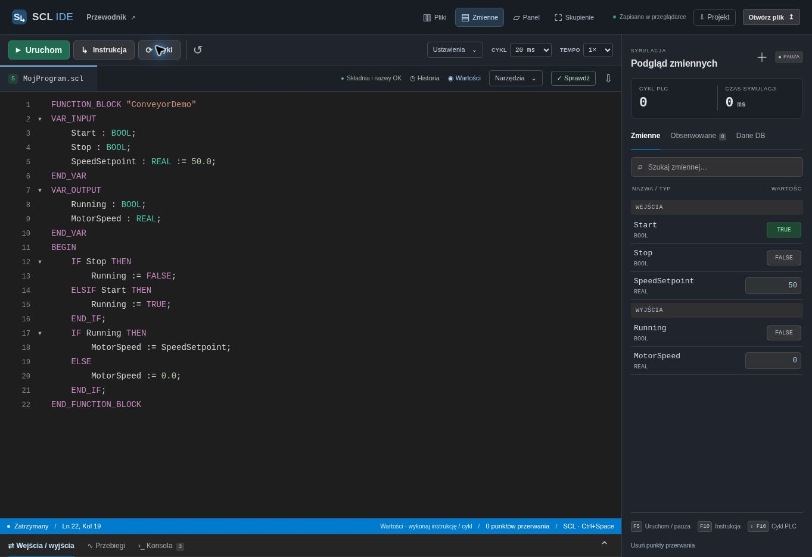

# SCL IDE

<p align="center"></p>
<p align="center">Built with <strong>HTML, CSS and JavaScript</strong>.<br><a href="https://tentypcic.github.io/scl-ide/">Open the app</a> · <a href="https://github.com/tentypcic/scl-ide/issues">Report Bug</a></p>

## 🧠 About The Project

**SCL IDE** is a browser workspace for writing, analysing and testing Siemens SCL before checking it in TIA Portal. The repository is named **scl-ide**; the app was previously called SCL Lab.

This interpreter executes a documented subset. It does not compile PLC machine code or establish full Siemens compatibility. SCL comes first; the WinCC VBScript adapter remains planned.

## 🛠 Features

- Programs, JSON import/export, recoverable trash and source history with comparison and restore.
- Syntax highlighting, completion, signatures, snippets, indentation and formatting.
- Nested IF / CASE / loop / REGION / VAR folding, preserving source through editing, copy and undo.
- PLC scans, simulated timers, typed variables, arrays and inline structures.
- Editable inputs during RUN, stepping, breakpoints, watches, inline values and signal traces.
- Resizable panels, focus mode, keyboard controls and a ready-to-run SCL sample.
- Source-range diagnostics and parser regressions for nested CASE, literals and block endings.

## 🚀 Getting Started

Node.js 22+ for tests; Python 3 or another static server for the app. No package installation or build step.

```sh
npm test
python3 -m http.server 8080 --directory dist
```

Open `http://localhost:8080`. ES modules require HTTP. Check a program, set inputs and run; **F10** steps an instruction, **Shift+F10** steps a scan. The hosted app is publicly accessible.

## 💾 Data and Recovery

Programs stay in browser storage for the current origin. No device or GitHub sync. Clearing site data can remove them: export project JSON regularly. Git history protects application source, not programs written in the browser. GitHub Pages uses a different origin from Sites: export project JSON from the old address and import it on Pages to move your programs. See [development and recovery](docs/DEVELOPMENT.md).

## 🧪 Tests and Limits

**152 tests pass** in the reconciled source checked on 1 November 2026. The original 44-test baseline is historical. Tests cover interpreter behaviour, parser errors, completion, folding, history, failed writes, live inputs and workspace controls.

One block/instance executes. User FC/FB calls, project-wide UDT resolution, hardware, Motion Control, communication and safety instructions remain unsupported. Numeric semantics are incomplete; timers use simulation time. The parser stops at its first error. TIA Portal / PLCSIM remain the reference.

## 📂 Documentation and Next Steps

[Architecture](docs/ARCHITECTURE.md) · [Roadmap](docs/ROADMAP.md) · [Parser audit](docs/M2-PARSER-AUDIT.md) · [Interface audit](docs/INTERFACE-AUDIT.md)

Next: tolerant language services, symbols/types and project DB/UDT definitions. Editor migration and VBScript remain separate milestones.

## 🧑‍💻 Author

Created by [tentypcic](https://github.com/tentypcic). Public source repository; no open-source licence is granted.
