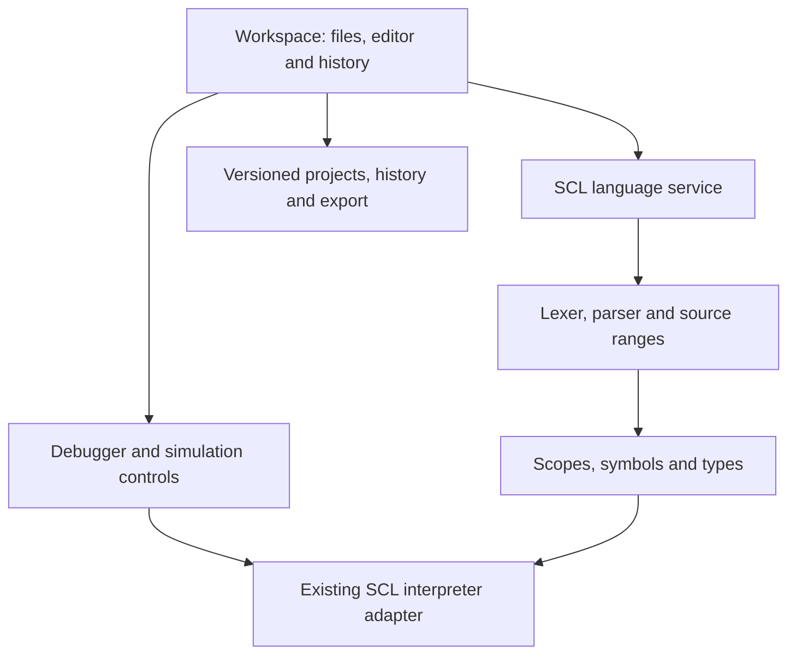

# Architecture — SCL first

Status: target architecture, with an incremental path from the working v5 baseline. Initial implementation: project history only. No parser or editor rewrite is included in M1.



## Boundaries

| Component | Responsibility | Current position / next step |
| --- | --- | --- |
| Workspace | Files, open program, settings, history, import/export | Currently `app.js`; extract storage/history first |
| Editor adapter | Text, selection, decorations, completion presentation | Existing textarea/highlight editor; evaluate Monaco separately |
| SCL language service | Diagnostics, completion, hover, definitions, references, formatting | Current assist/formatter behind a future common interface |
| Parser | Tokens, tolerant syntax tree, exact source ranges | Audit current `Parser`; fix nested CASE before replacement decisions |
| Semantic model | Scopes, declared types, symbols, resolved references | Build independently from runtime values |
| Runtime adapter | Instance memory, scan, simulated time, instruction budget | Retain `Machine`; no all-at-once rewrite |
| Debug protocol | Run / pause / next instruction / next scan, samples, breakpoints | Isolate existing generator-based execution from the UI |
| Project store | Atomic current + history writes, validation, migration, conflict checks | New standalone module with regression tests |

Editing an incomplete program must not execute it. Editor analysis uses a versioned document (`uri`, `version`, text). Runtime input is an explicitly compiled source version. Changing source marks runtime data stale until it is recompiled.

## Proposed language service contract

```ts
interface Document { uri: string; version: number; text: string }
interface SourceRange { start: number; end: number } // zero-based UTF-16, end exclusive
interface Diagnostic { range: SourceRange; severity: 'error' | 'warning' | 'info'; code: string; message: string }
interface TextEdit { range: SourceRange; newText: string }
interface LanguageService {
  update(document: Document): void;
  diagnostics(uri: string, version: number): Diagnostic[];
  complete(uri: string, version: number, offset: number): CompletionItem[];
  hover(uri: string, version: number, offset: number): HoverInfo | null;
  definition(uri: string, version: number, offset: number): Location | null;
  references(uri: string, version: number, offset: number): Location[];
  rename(uri: string, version: number, offset: number, name: string): WorkspaceEdit;
  format(uri: string, version: number): TextEdit[];
}
```

The additional item types will be defined when their milestone is implemented. Worker messages include request ID, document version and URI; the UI discards stale results. Introduce the worker after the synchronous contract is tested. Do not require a worker to migrate existing user data.

## Parser decision

Keep the existing parser at first. Audit correct and incomplete real SCL, source ranges, error recovery, nested CASE / loops, quoted global names and typed literals. Compare a small Tree-sitter prototype against the same fixtures only if the current parser cannot support the required recovery and incremental analysis. Record the result in a separate ADR before choosing a rewrite.

AST and semantic resolution are separate: a parsed member expression is not proof that a DB field exists. Compatibility reporting distinguishes parsed, resolved, executable and verified-against-TIA support.

## Project history design — M1

- A single `scl-lab-history-v1` envelope stores current project and recovery snapshots in one localStorage write. Failed writes cannot advance only half of that state.
- Existing v1/v2/v3 project keys remain untouched. Migration reads them only when no new envelope exists.
- Autosave batches typing after 800 ms idle and records the previous saved workspace before replacing it. It is not a per-keystroke log. Newline/text changes, names, trash and DB JSON are relevant; switching files or changing watches does not create a source revision.
- Additional checkpoints protect formatting, declaration insertion, imports, deletion and restoration. Restore records pending editor changes before switching the workspace. It restores all programs, trash, watches, breakpoints and stored settings, then resets simulation.
- Retain 30 latest automatic snapshots. Named snapshots are not automatically evicted; an envelope is capped at 500 entries. Browser storage quota can stop writes earlier; report it and provide JSON export.
- JSON exports include history. Imported history is validated before mutation and merged by revision identity. The history cannot recursively contain history.
- Compare code as plain text using bounded line LCS, with a complete-text fallback for large changed spans. The UI displays at most 2500 rows; the export retains complete sources.
- Compare-and-write against the last loaded envelope plus storage events detects stale tabs. localStorage does not provide a true multi-tab transaction: two simultaneously writing tabs can race between the read and write. This is best-effort conflict detection, not a multi-user collaboration protocol. Future IndexedDB transactions or Web Locks can strengthen it.
- Local history and downloaded backups are separate. Never describe localStorage as an independent or cloud backup.

## Later SCL milestones

Resolve DB / TYPE definitions and custom block calls in the language model before promising execution support. Add call frames and proper instance storage only when implementing runtime calls. Preserve deterministic PLC scan time; sampling must not re-evaluate expressions or affect program state.

## VBS later

Reuse workspace, editor adapter, diagnostics types and project history. Add a **separate** VBScript lexer/parser, semantic service and mocked WinCC host. SmartTags and HMI APIs come from an imported project profile. WinCC Unified JavaScript remains a different future language adapter. No VBS implementation starts before the SCL milestones are accepted.
